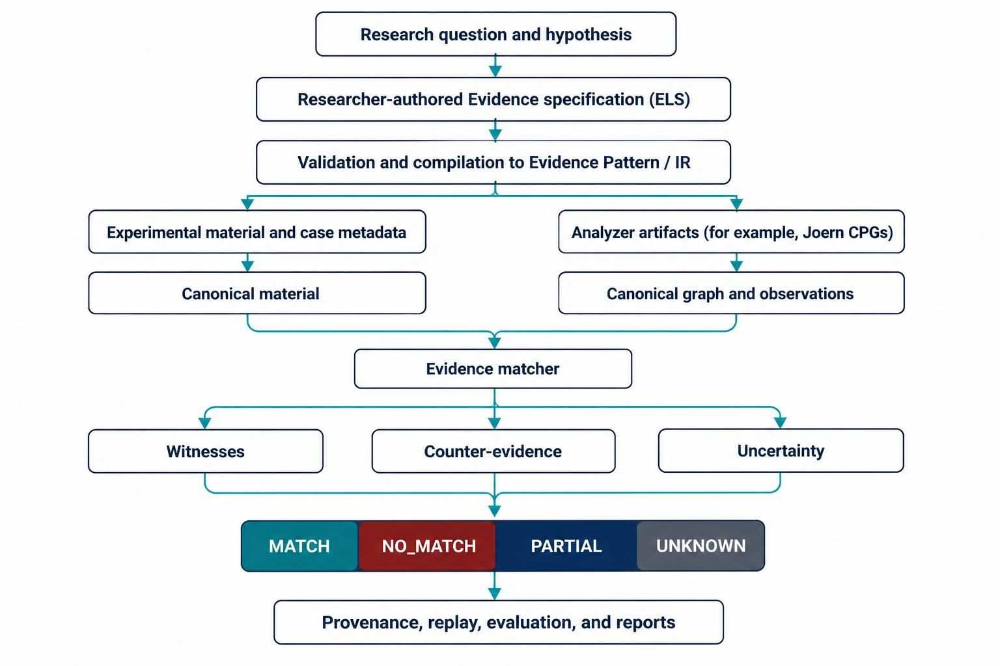

# EvidenceLab 1.0.0

**A researcher-driven framework for specifying, executing, validating, and evaluating vulnerability Evidence.**

EvidenceLab turns a security or program-analysis hypothesis into a machine-executable Evidence definition with explicit proof obligations, coherent witnesses, counter-evidence, uncertainty, provenance, and reproducible evaluation artifacts.

EvidenceLab is an **Evidence Laboratory**. Its central object is the researcher-authored Evidence definition, not a dataset, a benchmark, an analyzer, or a dashboard. External corpora and analyzers are inputs to the experiment. The researcher owns semantic decisions; EvidenceLab provides contracts and execution machinery to test those decisions.


## Start here

- [Documentation index](docs/README.md)
- [Installation guide](docs/installation.md)
- [Quickstart](docs/quickstart.md)
- [Architecture](docs/architecture.md)
- [Joern integration guide](docs/joern-integration.md)
- [CLI reference](docs/cli-reference.md)
- [Evidence Specification Language (ELS)](docs/evidence-dsl.md)
- [Dataset and experimental-material integration](docs/dataset-integration.md)
- [Research methodology](docs/research-methodology.md)
- [Troubleshooting](docs/troubleshooting.md)
- [Security model](docs/security-model.md)

## What EvidenceLab does

EvidenceLab provides a repeatable path from a research question to an auditable Evidence result:



The path is not a claim that every experiment must begin with a dataset or Joern. EvidenceLab can validate and run an Evidence definition against an already-normalized graph. Joern is an important supported analysis integration, but the canonical Evidence contract is designed to keep Evidence definitions independent of one analyzer's raw syntax.

## What EvidenceLab is not

EvidenceLab does not:

- replace Joern, CodeQL, Semgrep, Clang, or another program-analysis tool;
- automatically infer the researcher's intended vulnerability semantics;
- turn a dataset label into a positive Evidence result;
- assume missing graph facts mean that a vulnerability is absent;
- make a small bundled example corpus equivalent to an independent publication-grade benchmark;
- guarantee that an Evidence definition generalizes beyond the tested languages, programs, analyzers, and cases.

## Core concepts

| Concept | Meaning in EvidenceLab |
|---|---|
| **Observation** | A fact reported by an analyzer or read from an input artifact. It retains source and provenance context. |
| **Derivation** | A deterministic or explicitly justified transformation from identified inputs to a derived fact. |
| **Evidence** | A researcher-authored set of required semantic claims and proof obligations. |
| **Witness** | A coherent binding of concrete graph entities that satisfies the required claims together. |
| **Counter-evidence** | A refuting or disqualifying condition evaluated against the relevant witness, not an unrelated entity elsewhere in the graph. |
| **Canonical graph** | The normalized graph boundary consumed by the matching engine. Original analyzer data and supported raw properties should remain traceable. |
| **Evaluation outcome** | `MATCH`, `NO_MATCH`, `PARTIAL`, or `UNKNOWN`; these outcomes are not interchangeable. |
| **Experimental material** | Source code, benchmark cases, labels, findings, and metadata supplied for a research task. This is an input boundary, not the platform's core ontology. |

### Outcomes are deliberately conservative

- `MATCH`: at least one required, coherent witness is proven under the Evidence definition and its policies.
- `NO_MATCH`: the Evidence definition is not satisfied by a sufficiently complete and trustworthy input for the evaluated decision.
- `PARTIAL`: the applicable definition or execution explicitly permits a partial result and the result must not be treated as a complete match.
- `UNKNOWN`: the available information is insufficient to decide safely. Missing analysis, timeouts, truncated candidates, and unresolved values can require this outcome.

At the claim level, the proof states include `PROVEN`, `DISPROVEN`, `PARTIAL`, `UNKNOWN`, and `NOT_APPLICABLE`. `UNKNOWN` must never be silently rewritten as `NO_MATCH`.

## Installation

### Runtime installation

Use Python 3.11 or newer. From the extracted project directory:

```bash
python3 --version
python3 -m venv .venv
source .venv/bin/activate
python -m pip install --upgrade pip
python -m pip install -e .
python -m evidencelab --version
```

Expected version output:

```text
evidencelab 1.0.0
```

### Development and release-test installation

The release-test runner imports `pytest`. Runtime installation alone intentionally does not install test dependencies. For a development checkout, use this single command instead of the runtime install command above:

```bash
python3 -m venv .venv
source .venv/bin/activate
python -m pip install --upgrade pip
python -m pip install -e ".[dev]"
python -m pytest --version
```

`requirements-dev.txt` is also provided, but `.[dev]` installs the project and its declared development extra in one operation. See [Installation](docs/installation.md) for optional extras, offline considerations, and troubleshooting.

## Verify a fresh checkout

The recommended first pass is:

```bash
python -m evidencelab --version
python -m evidencelab --help
python -m evidencelab doctor
python -m evidencelab evidence validate \
  --spec examples/evidence-dsl/cwe121-fixed-write-research-grade.els
python -m evidencelab dataset-model-validate \
  --model examples/dataset-model/simple-vuln-dataset.json
```

Run the unit and regression suite after installing development dependencies:

```bash
python -m pytest -q
```

Run the complete release smoke, including all isolated tests and example workflows:

```bash
./scripts/release_test.sh
```

The release test invokes the live Joern end-to-end workflow unless `SKIP_JOERN_E2E=1` is set. If Joern is not installed, the script may pass its non-Joern checks and then stop at the Joern prerequisite. To test only the Python/package and bundled reference workflows, run:

```bash
SKIP_JOERN_E2E=1 ./scripts/release_test.sh
```

Skipping Joern means the live analyzer integration has **not** been tested. It is not a replacement for running [the Joern workflow](docs/joern-integration.md) on a machine with the required Joern tools available.

## Joern is a supported analyzer integration

[Joern](https://joern.io/) is an external static-analysis platform that constructs Code Property Graphs (CPGs) and supports graph queries and data-flow analysis. EvidenceLab can use Joern as an observation provider. The integration captures CPG artifacts and, when enabled, a data-flow slice; it records the source hash, analyzer version when available, command outputs, configuration, and analysis status in a capture manifest.

Joern is installed separately and is not bundled into the Python package. The current capture implementation requires `joern-parse` and `joern-export`; data-flow capture also requires `joern-slice`. Follow the [Joern integration guide](docs/joern-integration.md) for upstream installation links, dependency checks, capture output layout, timeouts, and live end-to-end testing.

## Evidence Specification Language (ELS)

ELS is a small, declarative language for authoring Evidence. It does not define datasets or replace the query language of an analyzer. A typical workflow validates the source definition, compiles it into the machine-oriented Evidence Pattern contract, and executes it against a canonical graph:

```bash
python -m evidencelab evidence validate \
  --spec examples/evidence-dsl/cwe121-fixed-write-research-grade.els

python -m evidencelab evidence compile \
  --spec examples/evidence-dsl/cwe121-fixed-write-research-grade.els \
  --out /tmp/fixed-write-pattern.json

python -m evidencelab evidence run \
  --spec examples/evidence-dsl/cwe121-fixed-write-research-grade.els \
  --graph examples/cwe-121/graphs/vulnerable.json \
  --out /tmp/fixed-write-result.json
```

See the [ELS reference](docs/evidence-dsl.md) for grammar concepts, selectors, claims, slots, witness coherence, counter-evidence, and supported semantics.

## External datasets are experimental material

EvidenceLab supports explicit import or mapping paths for experimental material. Depending on the input, the workflow can use a built-in importer, a declarative mapping, a programmatic adapter, a SARIF ingestion path, or a source-capture pipeline. The canonical material manifest preserves case identity, declared truth authority, provenance, artifact references, and source integrity wherever supplied.

Relevant documentation:

- [Dataset integration](docs/dataset-integration.md)
- [SARD and Juliet workflows](docs/real-world-runbook.md)
- [Benchmark design](docs/benchmark-design.md)
- [Leakage, lineage, and split controls](docs/research-methodology.md)

Supported importer commands include `dataset-import-sard`, `dataset-import-juliet`, `dataset-import-primevul`, `dataset-import-secvuleval`, and `dataset-import-diversevul`. Support means that an import path exists; it does not imply the project ships those datasets or has validated every upstream snapshot.

## Research evaluation

EvidenceLab includes mechanisms for:

- pattern auditing and schema validation;
- benchmark manifest auditing and composition;
- positive, negative, and unknown outcome handling;
- train/validation/test splitting, including group- and time-aware options;
- leakage and source-lineage audits;
- per-case evaluation artifacts and witness replay;
- evidence-dimension coverage inventories;
- research ledgers and artifact inventories;
- hidden-benchmark packaging and verification;
- readiness checks and profile-defined research gates.

A successful CLI execution or passing unit suite is a software validation result, not proof that an Evidence definition is scientifically valid or publication-ready. Publication and research gates must be met by suitable independent data and must not be bypassed by relabeling demo cases.

## Repository map

```text
README.md                   Project overview and first commands
pyproject.toml               Package metadata, runtime dependencies, CLI entry point
requirements-dev.txt         Test/development requirements
schemas/                    Machine-readable JSON Schema contracts
evidencelab/                 Python implementation and CLI
examples/                    Small reference artifacts and example research workspaces
profiles/                    Evaluation and research-gate profiles
datasets/                    Dataset registry/configuration metadata
docs/                        Detailed technical and operator documentation
scripts/                     Bootstrap, release, corpus, and Joern test helpers
tests/                       Unit, contract, regression, and security tests
```

The `schemas/` directory contains the machine-readable artifact contracts. The public release has package version `1.0.0` and artifact schema version `1.0`; the two version values serve different purposes.

## Security and trust boundaries

EvidenceLab parses structured inputs, external graph exports, researcher-defined material mappings, and benchmark manifests. These files are input, not trusted instructions. Run analyzers on untrusted code inside an appropriately isolated environment. Enforce time, memory, filesystem, and network controls at the host or container boundary. Preserve timeouts and analysis failures as infrastructure or completeness states; do not reinterpret them as vulnerability labels.

See [security model](docs/security-model.md).

## Project status and scope

The included CWE-120/CWE-121 files are reference and development research material. They demonstrate workflow and contract behavior; they are not, by themselves, a claim of externally validated precision, recall, or generalization across all CWE variants. Joern E2E results are environment-dependent and should be recorded from the specific installation used in an experiment.

## Citation  

The repository includes [`CITATION.cff`](CITATION.cff) for citation metadata.  

## License
[`MIT`](LICENSE)
