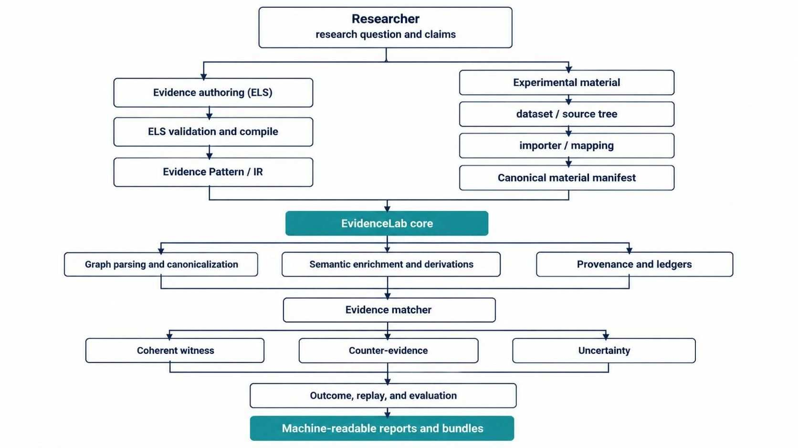

# Architecture

EvidenceLab separates what an analyzer observed, what a researcher asserts, and what the available evidence supports. Its central object is a researcher-authored Evidence definition. Dataset labels and analyzer output are inputs; neither automatically dictates the final result.

## Execution path



At a high level, EvidenceLab processes source code or datasets through an analyzer/importer to produce artifacts with identity and provenance. ELS definitions are validated and compiled into graph or material contracts, which support candidate bindings and claims.

## Main components

- **ELS and Pattern layer:** parses and validates concepts, selectors, slots, claims, witnesses, counter-evidence, and execution policies.
- **Analyzer boundary:** parsers accept supported graph representations, including EvidenceLab canonical graph JSON and selected GraphML, GraphSON, and Joern slice forms. The Joern adapter invokes external tools; it does not implement Joern.
- **Source dataset capture:** `capture-source-dataset` runs Joern capture for explicitly labeled C/C++ cases and writes `safe.json`, `vulnerable.json`, and `benchmark.json` with per-case artifacts. Labels come from the manifest; they are not inferred from analyzer output.
- **Material integration:** importers and declarative mappings convert supported external records into canonical experimental-material manifests while retaining identity and label authority.
- **Matcher:** evaluates claims under coherent bindings. Required facts about unrelated objects must not be combined into one witness.
- **Research tooling:** supports benchmark checks, provenance inventories, witness replay, splits, leakage audits, evaluation reports, and research-package gates.

## Keep these concepts separate

```text
dataset label
    != analyzer observation
    != derived fact
    != Evidence claim
    != witness
    != evaluation outcome
```

A dataset label such as `BAD` does not force `MATCH`. An analyzer's failure to emit a relation does not prove that the relation is absent. A derived fact should identify the observations and method from which it was derived. A research gate checks configured requirements; passing it does not prove that a hypothesis is sound or that results generalize.

## Package versions, schemas, and artifacts

The package version identifies a distribution of EvidenceLab. A schema or artifact-format version identifies the contract used to interpret a particular kind of data. These identifiers serve different purposes and must not be treated as interchangeable. When exchanging artifacts, consult the schema metadata and compatibility rules for that artifact type.

Schemas are stored in `schemas/`; reference patterns, graphs, and example workflows are under `examples/`.

Pattern migration normalizes a supported representation to the current contract. It does not certify the meaning or correctness of a migrated pattern; review and re-evaluate it.

## Failure and completeness boundaries

A syntactically valid artifact can still be semantically incomplete. A successful analyzer process can omit a relation needed by a claim. Preserve distinctions between missing executables, failed parsing/export, timeouts, truncated candidate search, rejected witnesses, complete non-matches, and unresolved cases.

See [Evidence reference](evidence-reference.md), [Joern integration](joern-integration.md), and [Security model](security-model.md).
